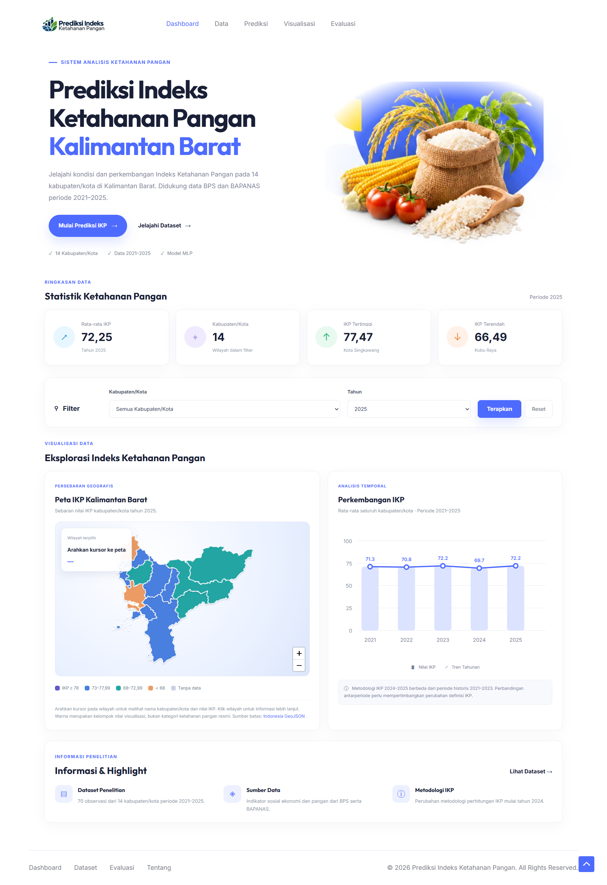
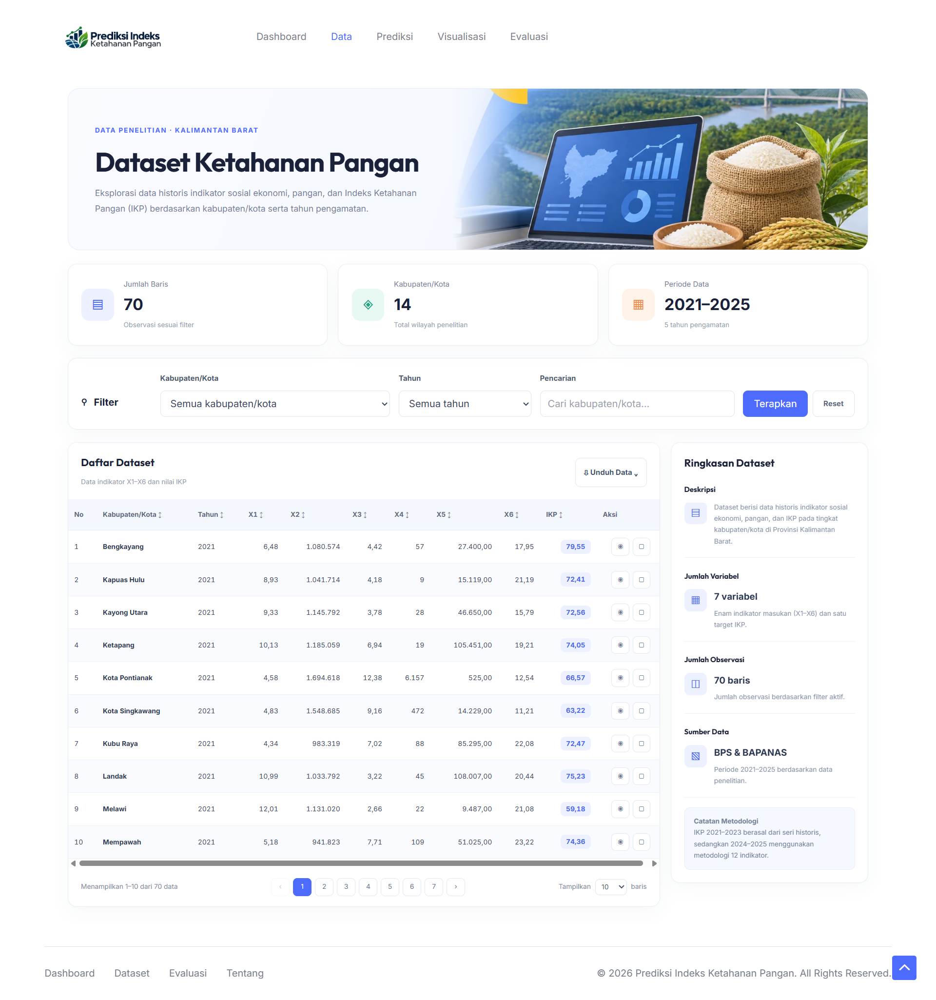
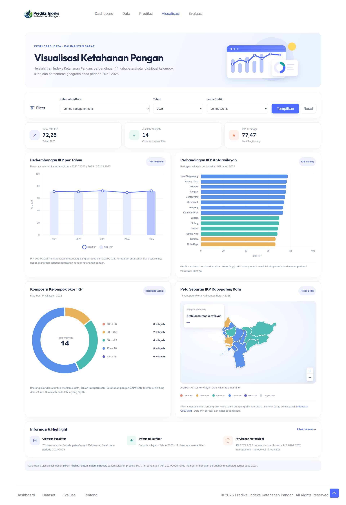
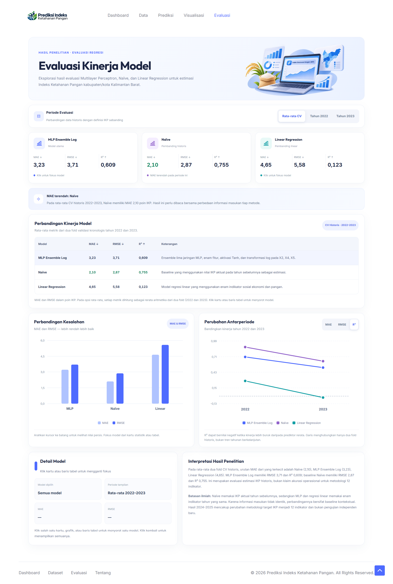

# Food Security Index Prediction
### Districts and Cities in West Kalimantan Province, Indonesia

**Implementation of Multilayer Perceptron Using BAPANAS and BPS Data**

A machine learning-based web application for estimating, exploring,
and visualizing the Food Security Index (FSI).

**Python · Flask · Scikit-learn · Tailwind CSS · Chart.js · Leaflet**

---

## Overview

This project implements the **Multilayer Perceptron (MLP)**
algorithm to estimate the Food Security Index (FSI) using
six socioeconomic and food-related indicators.

The application is developed using **Flask**, featuring
a responsive user interface, interactive visualizations,
and an integrated machine learning model to support
data exploration and research analysis.

### Research Information

| Information | Description |
|---|---|
| Research Field | Machine Learning / Food Security |
| Study Area | West Kalimantan Province, Indonesia |
| Unit of Analysis | 14 Districts and Cities |
| Data Period | 2021–2025 |
| Total Observations | 70 |
| Input Variables | 6 Indicators |
| Target Variable | Food Security Index (FSI / IKP) |
| Main Algorithm | Multilayer Perceptron (MLP) |
| Selected MLP Model | MLP Ensemble Log |
| Data Sources | Statistics Indonesia (BPS) and the National Food Agency (BAPANAS) |

---

## Application Features

The application consists of five integrated main pages.

| Page | Functionality |
|---|---|
| **Dashboard** | Displays summary statistics, annual FSI trends, and a geographic distribution map. |
| **Dataset** | Provides historical data exploration, searching, filtering, sorting, and data export. |
| **FSI Prediction** | Estimates FSI values using six input indicators and the MLP Ensemble Log model. |
| **Visualization** | Presents annual FSI trends, regional comparisons, score distributions, and interactive maps. |
| **Model Evaluation** | Compares MLP, Naïve, and Linear Regression using MAE, RMSE, and R². |

---

## Application Preview

The following sections showcase the user interface
of the developed web application.

### 01. Dashboard

The main dashboard provides an overview of food security
conditions, regional statistics, annual FSI trends,
and an interactive geographic map of West Kalimantan.

  

---

### 02. Dataset

The Dataset page presents historical socioeconomic
and food-related indicators across 14 districts and cities
for the period 2021–2025.

It includes searching, filtering, sorting, pagination,
and data export functionalities.

  

---

### 03. FSI Prediction

The Prediction page estimates Food Security Index values
based on six socioeconomic and food-related indicators
using the **MLP Ensemble Log** model.

The system provides input validation, estimated FSI values,
indicative interpretations, and temporary prediction history.

  

---

### 04. Visualization

The Visualization page enables interactive data exploration
through statistical charts and geographic maps.

Visualizations include annual FSI trends, regional comparisons,
score group distributions, and geographic patterns across
districts and cities in West Kalimantan.

  

---

### 05. Model Evaluation

The Model Evaluation page presents model performance
measurements using Mean Absolute Error (MAE),
Root Mean Squared Error (RMSE), and
the Coefficient of Determination (R²).

Users can compare the performance of MLP, Naïve,
and Linear Regression models during the historical
validation periods of 2022 and 2023.

  

---

## Research Methodology

The research methodology consists of the following stages:

1. Data collection and integration from BPS and BAPANAS.
2. Data quality assessment and preprocessing.
3. Chronological splitting of the dataset.
4. Development and training of several Multilayer Perceptron configurations.
5. Implementation of Naïve and Linear Regression as comparison methods.
6. Performance evaluation using MAE, RMSE, and R².
7. Integration of the trained model and research results into a Flask web application.

The selected MLP model uses an **ensemble learning approach**
that combines predictions from five MLP networks.

Logarithmic transformations are applied to selected input
features to address differences in scale and data distribution.

---

## Model Evaluation

Model performance was evaluated using a
**rolling-origin validation** approach over the
historical periods of 2022 and 2023.

| Model | MAE ↓ | RMSE ↓ | R² ↑ |
|---|---:|---:|---:|
| MLP Ensemble Log | 3.229 | 3.714 | 0.609 |
| Naïve | **2.101** | **2.866** | **0.755** |
| Linear Regression (6 Features) | 4.648 | 5.579 | 0.123 |

**MLP Ensemble Log** achieved the best performance
among the evaluated MLP configurations.

However, the Naïve method achieved lower prediction
errors during historical validation. This comparison
should be interpreted carefully because Naïve uses
the previous year's actual FSI value, while MLP
uses six indicators from the same year.

### Research Limitations

FSI values from 2021 to 2023 follow the historical
index methodology, whereas the 2024–2025 values
were calculated using a revised 12-indicator methodology.

This methodological change limits the comparability
of the target values across periods and affects
the interpretation of temporal generalization performance.

Furthermore, the available validation data is limited,
and the results should not be interpreted as evidence
of operational predictive reliability under the
revised methodology.

Predictions generated by this application are
**research-based estimates, not official Food Security
Index values published by BAPANAS**.

---

## Technology Stack

| Component | Technology |
|---|---|
| Backend | Python, Flask |
| Machine Learning | Scikit-learn, Multilayer Perceptron |
| Data Processing | Pandas, NumPy |
| Frontend | HTML, Tailwind CSS, JavaScript |
| Data Visualization | Chart.js |
| Geographic Visualization | Leaflet, GeoJSON |
| Model Serialization | Joblib |

---

## Source Code Availability

This repository is intended for **public documentation
and academic project presentation**.

The Flask application source code, trained machine
learning models, and research datasets are not included
in this public repository.

The repository contains application screenshots,
research information, and a summary of model evaluation.

---

## Author

**Roni, S.Kom.**

Machine Learning and Web Application Development

West Kalimantan, Indonesia

---

**Food Security Index Prediction — West Kalimantan**

Academic Research Project · 2026

